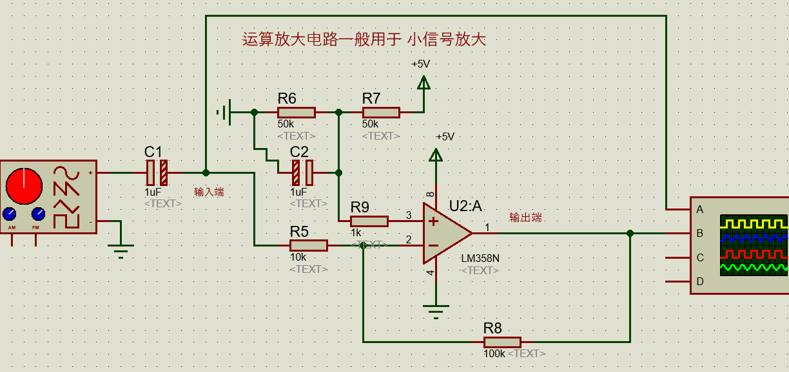

# 02-波峰焊、回流焊、常用集成电路

## 一、单选题

### 1. 图中是一个LM358运算放大电路，请问该电路的放大倍数是______倍？ P10

- A. 10
- B. -100
- C. 100
- D. -10

**参考答案：** D

### 2. 电路板制作回流焊工艺里，最常用的一种方式中的“回流”，指的是________？ P3末尾

- A. 高温的气体在回流焊炉中，来回循环流动加热实现焊接
- B. 高温的液体在回流焊炉中，来回循环流动加热实现焊接
- C. 高温的焊锡和助焊剂在焊炉中，产生波峰波谷来加热实现焊接
- D. 以上都不对

**参考答案：** A

### 3. 电路制作工艺中，回流焊与波峰焊的最大区别在于________？ P8

- A. 前者主要焊接贴片元件，后者主要焊接插孔元件
- B. 以上都不对
- C. 前者主要焊接插孔元件，后者主要焊接贴片元件
- D. 焊接的温度高低不同

**参考答案：** A

## 二、多选题

### 4. 关于电路板的回流焊工艺，描述正确的有________？ P8

- A. 第二步使用SMT自动贴片机把元器件放置到指定位置，依靠焊锡膏粘黏元器件
- B. 最后放入波峰焊炉进行加热焊接，再冷却
- C. 最后放入回流焊炉进行加热焊接，再冷却
- D. 首先用漏孔网和刮板，将焊锡膏刮落、滴落到指定的一些焊盘点位上

**参考答案：** A、C、D

### 5. 波峰焊一般有哪些步骤________？ P8

- A. 喷助焊剂
- B. 液态焊料的波峰，接触电路板下表面进行焊接
- C. 预热
- D. 冷却

**参考答案：** A、B、C、D
