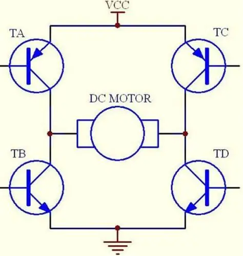

# 03-滤波及驱动电路

## 一、单选题

### 1. 电路中，正常的信号可能会受到电磁干扰，波形中混入了杂波信号，这时候需要增加___________电路？ P53

- A. 滤波
- B. 限波
- C. 整流

**参考答案：** A

### 2. 从电路滤除干扰的综合效果来看，最有效的是________组合电路？ P56

- A. RL（电阻+电感）
- B. LC（电感+电容）
- C. RC（电阻+电容）

**参考答案：** B

## 二、多选题

### 3. 电容器在电路中的特性是？ ________ P53-54

- A. 隔交流通直流
- B. 隔直流通交流
- C. 阻低频通高频
- D. 阻高频通低频

**参考答案：** B、C

### 4. 电感器在电路中的特性是？ ________ P54-55

- A. 隔交流通直流
- B. 阻低频通高频
- C. 隔直流通交流
- D. 阻高频通低频

**参考答案：** A、D

### 5. 很多智能系统如机器人的行走底盘一般由电机带动，关于可以控制直流电机正反转、也能控制转速的H桥驱动电路，下列描述正确的有___________？（笔记内容）

- A. 一般由四个开关晶体管或场效应管组成
- B. 开关管 Ta 和 Tc 导通时，电机MOTOR的电流从右向左流动，使电动机转动
- C. Tc 和 Td 可以同时导通
- D. 开关管 Ta 和 Td 导通时，电机MOTOR的电流从左向右流动，使电动机转动

**参考答案：** A、D
