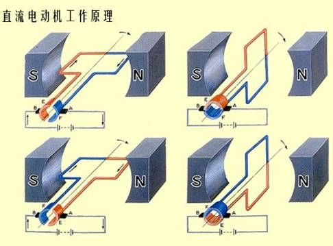
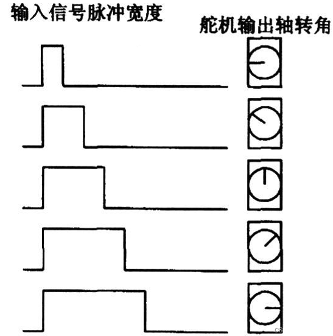

# 06-普通电机.步进电机.伺服电机(舵机)-new

## 一、单选题

### 1. 控制直流电动机旋转方向和调速的最常用方法是：________ ？ P90 和 课程理解

- A. 用开关管组成H桥控制方向，同时开关管给PWM信号控制转速
- B. 用开关手动控制
- C. 用开关管组成：星-三角电路来控制方向，同时开关管给PWM信号控制转速
- D. 用单片机加继电器控制方向和转速

**参考答案：** A

### 2. 根据步进电机工作原理图，对于步进电机的简单理解是：_____________？ P92

- A. 定子由多个绕组线圈磁极组成，转子永磁体的磁极数量一般为定子绕组磁极数减1，定子磁极依次通电，转子将一步步前进
- B. 以上说法都不对
- C. 定子由多个绕组线圈磁极组成，转子永磁体的磁极数量一般为定子绕组磁极数减2，定子磁极依次通电，转子将一步步前进
- D. 转子由多个绕组线圈磁极组成，定子永磁体的磁极数量一般为定子绕组磁极数减2，定子磁极依次通电，转子将一步步前进

**参考答案：** C

### 3. 要控制步进电机的转速，直接调整控制脉冲信号的频率即可？________ （课程实训所学）

- A. 对
- B. 错

**参考答案：** A

### 4. 直流电动机的工作原理主要基于以下哪种物理现象? P90

- A. 压电效应
- B. 静电感应
- C. 通电导体在磁场中受力
- D. 电磁感应

**参考答案：** C

### 5. 有刷直流电动机中，用于改变电枢绕组电流方向以实现连续旋转的部件是? P90

- A. 换向器
- B. 转子铁芯
- C. 电刷
- D. 定子

**参考答案：** A

### 6. 直流电动机调速方法中，以下哪种可以实现无级调速且效率高? P90

- A. 改变电枢电压
- B. 改变电枢回路电阻
- C. 改变极对数
- D. 改变励磁电流

**参考答案：** A

### 7. 步进电动机是一种将什么信号转换为角位移的执行器件? P92

- A. 脉冲信号
- B. 交流电压
- C. 直流电压
- D. 模拟电流

**参考答案：** A

### 8. 步进电动机的步距角是指? P91-92

- A. 转子每转一圈所需的脉冲数
- B. 最大允许转角
- C. 定子与转子之间的夹角
- D. 每输入一个脉冲信号，转子转过的角度

**参考答案：** D

### 9. 步进电动机在低频工作时容易出现什么现象? 刚才看的视频教程

- A. 振荡
- B. 堵转
- C. 失步
- D. 过热

**参考答案：** A

### 10. 舵机(伺服电机)通常用于控制? P93

- A. 精确的角度位置
- B. 直线位移
- C. 大扭矩输出
- D. 连续旋转速度

**参考答案：** A

### 11. 标准舵机的控制信号通常是? P94 第三段

- A. 串口数字信号
- B. 周期为20ms的PWM脉冲，脉宽0.5-2.5ms
- C. 模拟电压0-5V
- D. 直流电流信号

**参考答案：** B

### 12. 舵机在机器人应用中，主要用于? 课堂所讲和常识

- A. 提供大范围直线运动
- B. 驱动轮子连续旋转
- C. 控制关节角度
- D. 产生高频振动

**参考答案：** C

## 二、多选题

### 13. 直流电动机的主要优点有哪些？______________ P89

- A. 易于控制转动到精确的角度
- B. 调速范围更广，调速平滑
- C. 运行过程中，转矩力量大
- D. 可靠性高，控制方法简单
- E. 通交流电也能连续转动

**参考答案：** B、C、D

### 14. 尝试画出普通直流电动机的结构图，直流电机一般主要由哪些部分组成：_____________ ？ P90

- A. 转子：导线绕制的线圈和导电铜片
- B. 定子：两块以上的永磁铁
- C. 电刷换向器
- D. 定子：多组绕组线圈

**参考答案：** A、B、C

### 15. 伺服电机(也称舵机)的常见型号为180°舵机，关于180°舵机控制信号下面说法正确的有：________？ P93

- A. 控制信号的高电平时长为1.5ms时，舵机精确转动到90°
- B. 控制信号的高电平时长为1.8ms时，舵机精确转动到180°
- C. 信号一般为周期2ms的方波脉冲信号
- D. 信号一般为频率50Hz的方波脉冲信号
- E. 控制信号的高电平时长为0ms时，舵机精确转动到0°
- F. 控制信号的高电平时长为0.5ms时，舵机精确转动到0°

**参考答案：** A、D、F

### 16. 舵机的内部通常包含哪些部分? P93图

- A. 控制电路板
- B. 减速齿轮组
- C. 位置反馈电位器
- D. 直流电机

**参考答案：** A、B、C、D
